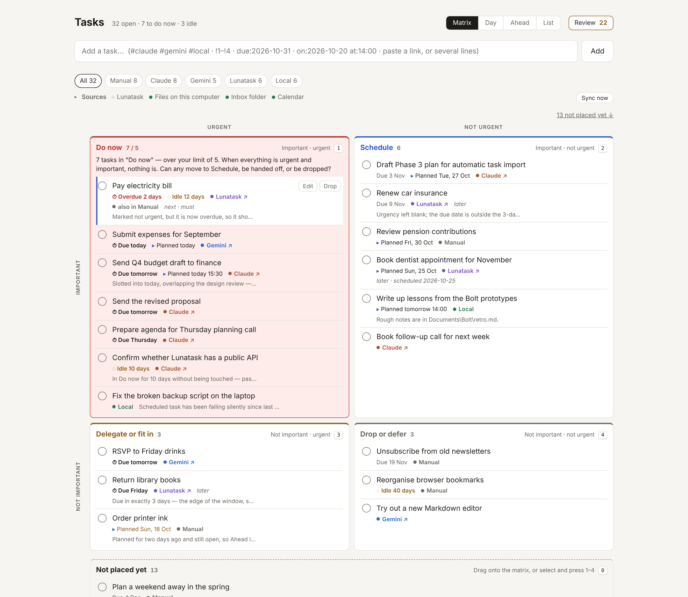
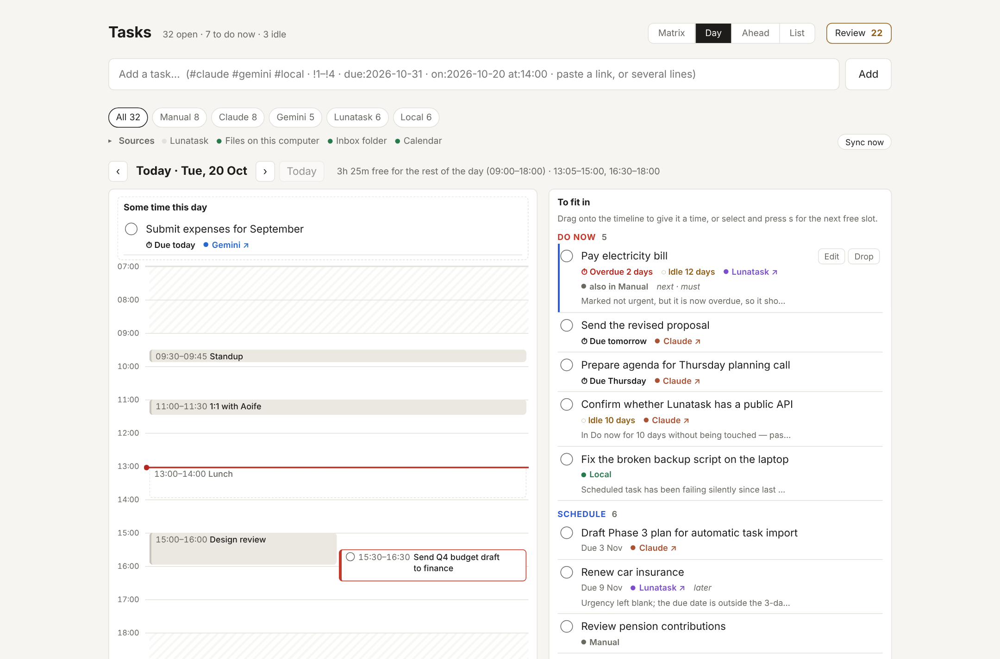

# Task oversight

One place to see and prioritise tasks that currently live across Claude,
Gemini, Lunatask and my own machine. Single user, runs locally.

My tasks were spread across two AI assistants, a task manager and notes on
my PC, and no single list was complete. This app pulls them into one view,
ranks them on an Eisenhower matrix and puts them against the calendar, so
"what should I be doing now?" has one trustworthy answer. The task data
never leaves the machine it runs on.



## What it does

- **One list from five sources.** Lunatask (over its API), Claude and
  Gemini (paste a block, or drop a file in an inbox folder), checkboxes and
  TODOs in local notes, plus anything typed in. Every source is read-only:
  nothing is written back.
- **Eisenhower prioritisation, built in.** Due dates raise urgency on their
  own, and an overloaded "Do now" is flagged.
- **Time.** A Day view puts tasks against the calendar and shows the free
  time left, and Ahead shows the next 14 days.
- **Keeping it honest.** Duplicates are suggested but never merged
  automatically, idle tasks are flagged, a review clears what needs
  deciding, and a failed sync shows as a banner rather than failing silently.



## Privacy and safety

- **Local only.** It runs on `localhost` and keeps tasks in one JSON file on
  the machine. There's no hosted back end, no sign-up and no analytics; the
  only outbound calls are the read-only syncs from Lunatask and the calendar.
- **Only this page and this computer can change tasks.** Requests from other
  websites are refused, which closes off cross-site requests and DNS
  rebinding ([D17](docs/DECISIONS.md)).
- **Data is never lost.** Nothing is ever deleted, saves are all-or-nothing,
  and a task file the app can't read is never overwritten ([D18](docs/DECISIONS.md)).
- **Secrets stay out of git.** The Lunatask token and calendar addresses
  live in `.env`, and personal data in `data/`; both are git-ignored.
- **Deliberate capture, not scraping.** AI conversations reach the list only
  when I paste or drop them in ([D9](docs/DECISIONS.md)).

## How this was built

I owned the product, and an AI coding agent (Claude) wrote the code.

- **Job stories first.** The [backlog](BACKLOG.md) is written as
  *When …, I want …, so I can …*, in phases that are each usable on their own.
- **Every structural choice has a written reason.** There are 18 numbered
  [decisions](docs/DECISIONS.md), from the stack to who may call the API.
- **Reviewed in small steps.** I read and questioned every change, and the
  commit history follows the phases.
- **Tested, then hardened.** A full [QA pass](docs/qa-2026-10-14.md) found
  one high-severity issue and eleven smaller ones. Each was fixed with a
  test that failed first, and then retested. 154 tests run on Node's
  built-in runner.

## Documentation

- **Why it exists and what's in scope:** [`CONTEXT.md`](CONTEXT.md)
- **What gets built, in what order:** [`BACKLOG.md`](BACKLOG.md)
- **Why it's built the way it is:** [`docs/DECISIONS.md`](docs/DECISIONS.md)
- **Full documentation** — setup, user guide, architecture, data model,
  API, development, QA: [`docs/README.md`](docs/README.md)

## Running it

Needs [Node.js](https://nodejs.org) 22.18 or newer (check with `node --version`).
Nothing else needs installing to run it.

```
npm start
```

Then open <http://localhost:4321>. Tasks are saved to `data/tasks.json` in this
folder. To change that or anything else, put these in a `.env` file in this
folder (copy `.env.example`) or set them before `npm start`:

| Setting | Default | What it does |
|---|---|---|
| `TASKS_FILE` | `data/tasks.json` | Where tasks are saved |
| `PORT` | `4321` | Which port the page is on |
| `URGENT_WITHIN_DAYS` | `3` | Due within this many days = urgent |
| `DO_NOW_LIMIT` | `5` | "Do now" is flagged above this many |
| `STALE_AFTER_DAYS` | `30` | A task you haven't touched this long is flagged idle |
| `DO_NOW_STALE_AFTER_DAYS` | `7` | …or this long, if it's in "Do now" |
| `LUNATASK_TOKEN` | — | Turns on the Lunatask sync (see Sources) |
| `LOCAL_FOLDERS` | — | Folders to scan for `- [ ]` and `TODO:` lines, separated by `;` |
| `INBOX_FOLDER` | `data/inbox` | Where dropped-in task files are picked up |
| `SYNC_EVERY_MINUTES` | `15` | How often to sync; `0` = only on "Sync now" |
| `CALENDAR_URLS` | — | Your calendar's private iCal (.ics) address, or an .ics file; several separated by `;` (see Calendar) |
| `DAY_HOURS` | `09:00-18:00` | Your working day: free time in the Day view is counted inside it |

```
# PowerShell
$env:TASKS_FILE = "C:\path\to\tasks.json"; $env:DO_NOW_LIMIT = 4; npm start
```

### Trying it with sample data

```
npm run sample
```

Writes about 30 made-up tasks to `data/sample-tasks.json` and starts the app
on that file instead of your real one. It also makes a sample notes folder
and leaves a file in a sample inbox, so the first sync has something to
pick up, plus a sample calendar with meetings this week and tasks slotted
into today and tomorrow; it never syncs your real Lunatask, notes, inbox or
calendar. One of its two calendars is missing on purpose, so you can see
the red "hasn't synced" banner. The other one works. Due dates are set relative to today,
so there's always something overdue, something due today and an overfull
"Do now"; there are also two likely duplicates to merge and some closed
tasks to reopen. Run it again to reset. The source links are made up, so
they open the right site but not a real conversation. Details at the top of
`scripts/sample-data.ts`.

## Using it

The page opens on an **Eisenhower matrix**, with "Do now" (important and
urgent) top-left and its first task already highlighted. "Matrix" / "List"
at the top right (or `v`) switches to the plain list.

Type in the box at the top and press Enter. Optional shortcuts in the same
line:

| Type | Effect |
|---|---|
| `#claude` `#gemini` `#lunatask` `#local` | Records where the task came from |
| `!1` `!2` `!3` `!4` | Places it: Do now, Schedule, Delegate, Drop/defer |
| `due:2026-10-31` | Sets a due date |
| `on:2026-10-20` | Plans it for that day |
| `at:14:00` | Gives it a 30-minute slot at that time (today, unless there's an `on:`) |
| a pasted `https://…` link | Becomes a link back to it in that system — a `claude.ai` or Gemini link also sets the source |

So `Send Sarah the budget #claude !1 https://claude.ai/chat/abc` adds a task
tagged Claude, straight into "Do now", with the coloured "Claude ↗" label
linking to the conversation. Without `!1`–`!4` a task waits in "Not placed
yet" under the matrix.

**Moving tasks:** drag between quadrants, or select a task and press a
number. Set a due date in the edit panel (`e`).

| Key | Does |
|---|---|
| `n` | add a task |
| `j` / `k` | move down / up |
| `1` `2` `3` `4` | move to Do now / Schedule / Delegate / Drop or defer |
| `0` | back to "Not placed yet" |
| `i` / `u` | flip important / urgent |
| `x` / `d` | done / drop |
| `e` | edit |
| `o` | open the source link |
| `s` | schedule: in the Day view, the next free slot; elsewhere, opens the edit panel |
| `[` / `]` | Day view: the day before / after |
| `t` | Day view, today |
| `v` | next view: Matrix → Day → Ahead → List |
| `r` | start a review |
| `Esc` | leave a text box |

**Due dates move tasks for you.** Anything due within 3 days, or overdue,
counts as urgent whatever you said, so it rises into "Do now" (or
"Delegate") on its own as the day approaches. The due label gets a ⏱ when
that's what's making it urgent.

**Too much in "Do now"?** Over 5 tasks, the quadrant turns red and says so.

### Day and Ahead (planning your time)

**Day** puts the day's calendar beside your list. The left side is a
timeline of your meetings; the right side is everything still to fit in,
Do now first. **Drag a task onto the timeline** to give it a time (it snaps
to 15 minutes and takes 30 unless you change it in the edit panel). Drag it
onto *Some time this day* to plan the day without a time, or back to the
right to unplan it. Select a task and press `s` to drop it into the first
free gap. The header shows how much free time is left in your working day
(`DAY_HOURS`), from now if it's today. Events marked "free" in your
calendar, like lunch, are drawn dashed and don't count as busy. `[` and `]`
move between days.

**Ahead** shows the next 14 days: what's overdue, anything you planned for
an earlier day and haven't done, then each day's events, slotted tasks,
planned tasks and deadlines, then the next few deadlines after that. Click
a day to open it in Day.

In the matrix and list, a planned task shows *▸ Planned Thu 14:00*.

### Keeping it honest

**Idle tasks.** A task you haven't touched for 30 days, or 7 in "Do now",
shows *◌ Idle 34 days*. Syncs don't count as touching it; editing, placing,
scheduling or saying "still relevant" does. Tasks with a due date or
planned day still ahead aren't flagged, because they're waiting on purpose.

**Review.** The **Review** button (or `r`) shows how many tasks need a
decision and walks through them one card at a time: unplaced tasks,
unnamed Lunatask tasks, overdue, planned for a day that's gone, idle, then
"Do now" if it's over its limit. Each card has the decisions that fit:

| Key | On a review card |
|---|---|
| `1`–`4` | move it to that quadrant |
| `k` | still relevant: keep it as it is (resets the idle clock) |
| `x` / `d` | done / drop |
| `n` | type its name (unnamed Lunatask tasks) |
| `e` | edit |
| `→` / `←` | skip / go back |
| `Esc` | stop |

Everything has an Undo. Skipped cards come back next time.

**When a sync fails,** a red banner at the top says which source, since
when and why, with a *Sync now* button. It also appears if a source hasn't
synced successfully for over two sync intervals, in case a sync is stuck
rather than failing. The source's filter chip gets a ⚠. If the page loses
the app itself (say the terminal was closed), it says *Can't reach the app*
until it's back.

Completing, dropping and merging all show an **Undo** for a few seconds, and
anything closed can be reopened from "Done, dropped and merged" at the bottom.

When two open tasks look like the same thing, a **possible duplicates** box
appears above the list. Merging keeps one task and remembers both sources;
"Not the same" stops that pair being suggested again.

## Sources

The **Sources** line under the filters shows each source's last sync (click
it for details and errors). **Sync now** syncs everything; it also happens
on start and every 15 minutes. Nothing is ever written back to another
system — see `docs/DECISIONS.md`, D8.

**Lunatask.** In the Lunatask desktop app: Settings → Access tokens →
create one. Put it in `.env` as `LUNATASK_TOKEN=…` and restart. Every open
Lunatask task then appears here, placed on the matrix by its Lunatask
quadrant. **Lunatask encrypts task names, so its API can't send them**:
each arrives as *Unnamed Lunatask task*, with its Lunatask status
underneath. Click the purple "Lunatask ↗" to open it there, then click the
title (or press `e`) and type its name — once per task. Completing or
deleting it in Lunatask closes it here; completing it here doesn't touch
Lunatask.

**Claude and Gemini.** At the end of a conversation, ask:

> List what we agreed I'd do as a task block: this conversation's link on
> the first line, then one task per line as `- title`, with `!1`–`!4` if
> it's clear which quadrant, and `due:YYYY-MM-DD` if there's a date.

Copy the answer and paste it into the capture box — every line becomes a
task, tagged with the source and linked to the conversation. Pasting the
same block again adds nothing. Or save the block as a `.md` file in
`data/inbox`: it's picked up at the next sync and moved to
`data/inbox/processed`. That's also how a Claude session working on this
computer can hand tasks over.

```
https://claude.ai/chat/abc123
- Send Sarah the budget draft !1 due:2026-10-17
- Book the venue for the offsite !2
```

**Files on this computer.** Set `LOCAL_FOLDERS` to your notes folders. In
`.md` and `.txt` files, `- [ ] …` lines and `TODO: …` lines become tasks
(code files are ignored). Tick the box or delete the line and the task
closes here at the next sync.

## Calendar

Lunatask's API doesn't include the calendar, so the app reads your calendar
straight from its **private iCal address**. That's a link that lets
read-only apps see your calendar. It's read-only: nothing is ever added to
your calendar, and events are never stored as tasks.

- **Google Calendar:** on the web, Settings → (your calendar, under
  "Settings for my calendars") → Integrate calendar → **Secret address in
  iCal format**.
- **Outlook / Microsoft 365:** on the web, Settings → Calendar → Shared
  calendars → **Publish a calendar** → choose "Can view all details" →
  copy the **ICS** link. (Some work accounts have this turned off by IT;
  if the option isn't there, that's why.)
- **iCloud:** in the Calendar app, share the calendar as a **Public
  Calendar** and copy the link (it starts `webcal://`, which is fine).

Put it in `.env` and restart. Several calendars go on one line, separated
by `;`:

```
CALENDAR_URLS=https://calendar.google.com/calendar/ical/…/basic.ics
```

**Treat that address like a password:** anyone with it can read your
calendar. `.env` never goes to GitHub, and the app never shows the address
on the page. If it leaks, reset it in the calendar's settings and paste the
new one in.

Calendars update with the other sources (every 15 minutes, or *Sync now*),
but providers refresh the address on their own schedule, so a meeting added
a minute ago may take a while to appear. If a calendar can't be fetched,
the last good copy stays on screen and *Sources* says so.

## Developing

```
npm install        # once — only fetches TypeScript, for type checking
npm test           # runs the tests in test/
npm run typecheck
```

| Where | What |
|---|---|
| `src/model.ts` | The `Task` type — start here |
| `src/tasks.ts` | Every rule about what can happen to a task |
| `src/priority.ts` | The Eisenhower rules: quadrants, due-date urgency, overload |
| `src/capture.ts` | Parsing the one-line quick-add |
| `src/duplicates.ts` | How likely duplicates are spotted |
| `src/sync.ts` | Phase 3: the rules for mirroring another system's tasks |
| `src/agenda.ts` | Phase 4: tasks and events laid out by day, and free time |
| `src/review.ts` | Phase 5: what needs a decision, in what order |
| `src/calendar/` | Phase 4: reading .ics calendars (`ics.ts`) and time zones (`zones.ts`) |
| `src/sources/` | One file per source: Lunatask, local files, inbox folder, calendar |
| `src/sync-runner.ts` | Runs the sources, on a timer and on "Sync now" |
| `src/store/` | Storage interface + the JSON file implementation |
| `src/app.ts` | HTTP routes (the API is listed at the top of the file) |
| `src/server.ts` | Startup: wires everything together |
| `public/` | The page: `index.html`, `app.js`, `styles.css` |
| `test/` | One test file per source file, plus end-to-end API tests |
| `scripts/sample-data.ts` | Sample tasks for `npm run sample` |
